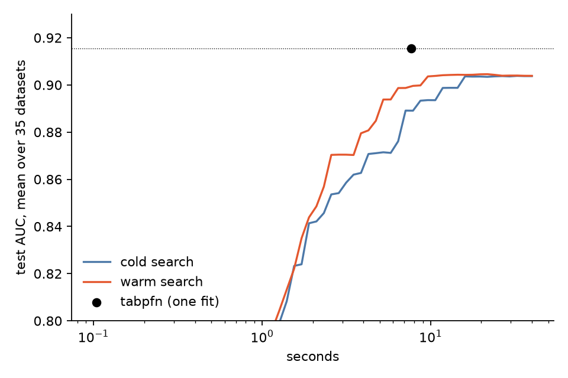

# search vs pretraining

wip, started 15 Nov 2026

In my bachelor thesis ([code](https://github.com/jennifoofoo/automl-workbench)) I tried to
make AutoML search faster by starting from configs that worked on similar datasets.
TabPFN doesn't search at all, it just predicts. I used SMAC back then, which comes from
Frank Hutter's group, and so does TabPFN. So I wanted to know what's left of my approach
once the search is gone.

35 small datasets from OpenML-CC18, 3 seeds, ROC AUC on a 30% test split.

- cold: random search over logreg, knn, rf, extra trees, xgboost (40 configs)
- warm: same, but the first 10 configs come from the 5 most similar datasets.
  core idea of my thesis, rebuilt in a small version
- tabpfn: one fit, no tuning

| | test AUC | time per dataset |
|---|---|---|
| cold | 0.904 | ~24 s |
| warm | 0.904 | ~25 s |
| tabpfn | 0.916 | ~8 s on cpu |

tabpfn is ahead on 26 of 35 datasets, 8 ties, search wins one.
warm start is ahead of cold early on (after 3 to 10 configs), after 40 no difference.



where the gap is biggest (`results/gap.png`, `results/per_dataset.csv`): on the medium hard
datasets, where the search ends up between 0.85 and 0.95 AUC, tabpfn is about 0.02 ahead.
On the easy ones (search above 0.99) there is nothing left to win. The gap is also smaller
on mostly categorical data (0.004 vs 0.012 on numeric). With 35 datasets these are
tendencies, not more. kc2 and credit-g were in my thesis experiments too: a tie on kc2,
tabpfn slightly ahead on credit-g.

40 random configs is a small search though, and timings are rough (4 processes in parallel).

`leads/` is what I started with: tabpfn vs logreg vs xgboost on four buy/churn datasets
with only 50 to 1000 rows.

```
uv sync
uv run python run_search.py cold
uv run python run_search.py warm
uv run python run_tabpfn.py    # needs TABPFN_TOKEN in .env
uv run python analyze.py
```
